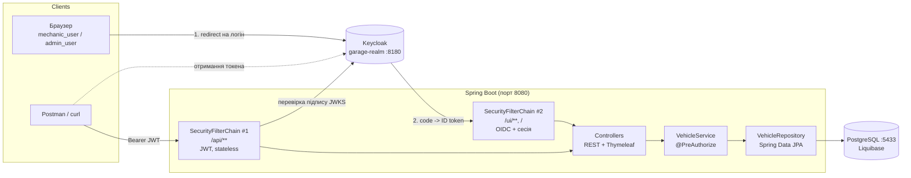

# Лабораторна робота №1. Spring Security

**Проєкт:** VAG.CV Fleet & Garage Platform (`com.vagcv.garage`)
**Гілка:** `lab-1-security`

---

## 1. Мета роботи

Закласти технічний фундамент семестрового проєкту, на якому в наступних лабораторних нарощуватиметься функціональність:

- обрати предметну область з розрахунком на розвиток у багатомодульну систему;
- реалізувати базовий CRUD на стеку Controller → Service → Repository → Spring Data JPA/Hibernate → Entity ↔ DTO (MapStruct);
- віддати керування схемою БД інструменту міграцій (Liquibase);
- додати простий UI;
- налаштувати **дві паралельні моделі автентифікації**: OIDC (Keycloak) для UI і JWT для прямих API-запитів;
- показати обмеження доступу **двома способами**: у `SecurityFilterChain` та через `@PreAuthorize`;
- підготувати готову Postman-колекцію.

## 2. Предметна область

VAG.CV це автогараж, що займається **викупом, ремонтом, підготовкою та перепродажем вживаних автомобілів**. Система веде облік автопарку, показує очікуваний прибуток від кожної угоди та розмежовує права працівників.

Чому саме ця область підходить для багатомодульної системи (ЛР 7–10): вона природно ділиться на самостійні контексти, наприклад облік автопарку (`fleet`), угоди та перепродаж (`deals`), сповіщення/публікація оголошень (`notifications`), аналітика (VIN-історія, оцінка ринкової ціни). Поточна ЛР закладає ядро: сутність `Vehicle` і модель безпеки.

**Ролі працівників:**

| Роль | Користувач (Keycloak) | Що може |
|---|---|---|
| `ADMIN` | `admin_user` | Усе: перегляд, створення, редагування, зміна статусу, **видалення**, адмін-звіт по автопарку |
| `MECHANIC` | `mechanic_user` | Перегляд, створення, редагування, зміна статусу. **Не може** видаляти авто та відкривати адмін-звіт |

## 3. Технології

| Шар | Технологія |
|---|---|
| Мова / фреймворк | Java 21, Spring Boot 3.4 (Web MVC, Data JPA, Validation) |
| БД та міграції | PostgreSQL 16, Liquibase (YAML-changelog) |
| Мапінг | MapStruct 1.6 (+ Lombok) |
| Безпека | Spring Security: OAuth2 Client (OIDC) + OAuth2 Resource Server (JWT) |
| Identity Provider | Keycloak 26 (`garage-realm`, порт 8180) |
| UI | Thymeleaf + thymeleaf-extras-springsecurity6 |
| Інфраструктура | Docker Compose (PostgreSQL + Keycloak) |
| Тести / інструменти | JUnit 5, Spring Security Test, Postman |

## 4. Архітектура



Шари застосунку: `web` (контролери) → `service` (бізнес-логіка) → `repository` → `domain` (Entity). Між зовнішнім світом і доменом стоять DTO, а перетворення виконує MapStruct. Entity назовні не віддаються.

## 5. Структура проєкту

```
vagcv-garage/
├── docker-compose.yml                 # PostgreSQL + Keycloak
├── keycloak/garage-realm.json         # realm, клієнти, ролі, користувачі (імпортується автоматично)
├── postman/vagcv-garage-lab1.postman_collection.json
├── pom.xml
└── src/main
    ├── java/com/vagcv/garage
    │   ├── GarageApplication.java
    │   ├── config/        SecurityConfig, AppConfig
    │   ├── security/      KeycloakRoles (claims -> ROLE_*)
    │   ├── domain/        Vehicle, VehicleStatus
    │   ├── repository/    VehicleRepository
    │   ├── dto/           VehicleRequestDto, VehicleResponseDto, FleetSummaryDto
    │   ├── mapper/        VehicleMapper (MapStruct)
    │   ├── service/       VehicleService
    │   ├── exception/     NotFoundException, ConflictException
    │   └── web/
    │       ├── api/       REST-контролери + ApiExceptionHandler
    │       └── ui/        Thymeleaf-контролери
    └── resources
        ├── application.yml
        ├── db/changelog/  db.changelog-master.yaml + changes/001, 002
        └── templates/     index, vehicles, vehicle-form, admin-summary, fragments
```

## 6. Модель даних і міграції

Таблиця `vehicles` створюється **тільки** Liquibase-міграцією `001-create-vehicles.yaml`; `spring.jpa.hibernate.ddl-auto=none`, тобто Hibernate схему не створює й не змінює. Міграція `002-seed-vehicles.yaml` додає три демонстраційні авто (по одному на кожен статус).

| Колонка | Тип | Опис |
|---|---|---|
| `id` | BIGINT, PK, autoincrement | |
| `vin` | VARCHAR(17), unique, not null | VIN-код |
| `brand`, `model` | VARCHAR(50) | Марка, модель |
| `manufacture_year` | INT | Рік випуску |
| `mileage_km` | INT | Пробіг |
| `purchase_price` | NUMERIC(12,2) | Ціна викупу |
| `target_resale_price` | NUMERIC(12,2) | Цільова ціна перепродажу |
| `status` | VARCHAR(20) | `IN_REPAIR`, `READY_FOR_SALE`, `SOLD` |
| `created_by` | VARCHAR(100) | Оператор, який вніс/змінив авто (`preferred_username`) |
| `updated_at` | TIMESTAMP WITH TIME ZONE | Час останньої зміни |

Applied-міграції Liquibase фіксує у службовій таблиці `databasechangelog`. Це видно на скріншоті в п. 9.

**Обчислюване поле.** У `VehicleResponseDto` є `expectedProfit = targetResalePrice − purchasePrice`. Воно не зберігається в БД, а рахується в MapStruct-мапері.

## 7. Функціонал

### 7.1 REST API (`/api/**`, автентифікація JWT)

| Метод і шлях | Хто має доступ | Опис | Відповіді |
|---|---|---|---|
| `GET /api/me` | будь-який автентифікований | Ім'я та ролі з токена | 200 |
| `GET /api/vehicles` | автентифікований | Список авто | 200 |
| `GET /api/vehicles/{id}` | автентифікований | Авто за ID | 200, 404 |
| `POST /api/vehicles` | автентифікований | Створення (статус `IN_REPAIR`) | **201**, 400 (валідація), 409 (дублікат VIN) |
| `PUT /api/vehicles/{id}` | автентифікований | Оновлення | 200, 400, 404, 409 |
| `POST /api/vehicles/{id}/ready-for-sale` | автентифікований | Статус → `READY_FOR_SALE` | 200, 404, **409 якщо авто вже `SOLD`** |
| `DELETE /api/vehicles/{id}` | **лише ADMIN** (`@PreAuthorize`) | Видалення | 204, **403** для MECHANIC, 404 |
| `GET /api/admin/summary` | **лише ADMIN** (SecurityFilterChain) | Зведення по автопарку | 200, **403** для MECHANIC |

Без токена будь-який `/api/**` повертає **401**. Помилки повертаються у форматі RFC 7807 (`ProblemDetail`); для 400 є поле `errors` із повідомленням по кожному полю.

### 7.2 UI (`/ui/**`, автентифікація OIDC)

| Сторінка | Що робить |
|---|---|
| `/` | Головна: хто увійшов і з якими ролями |
| `/ui/vehicles` | Таблиця авто (з очікуваним прибутком), кнопки Edit / Ready for sale / Delete |
| `/ui/vehicles/new`, `/{id}/edit` | Форми створення й редагування з показом помилок валідації |
| `/ui/admin/summary` | Зведення по автопарку (лише ADMIN) |

Кнопка **Delete** відображається лише для ADMIN (`sec:authorize`), але справжній захист це `@PreAuthorize` у сервісі. Прихована кнопка лише зручність, а не безпека.

### 7.3 Бізнес-правила

- Нове авто завжди створюється зі статусом `IN_REPAIR`.
- VIN унікальний: при створенні й оновленні дублікат дає `409 Conflict` (в UI помилка біля поля VIN).
- VIN має рівно 17 символів: цифри та великі латинські літери без `I`, `O`, `Q`.
- Авто зі статусом `SOLD` **не можна** повторно виставити на продаж (`409`).
- Кожна зміна фіксує оператора (`created_by`) та час (`updated_at`).

## 8. Безпека

### 8.1 Дві паралельні моделі автентифікації

Налаштовані два незалежні `SecurityFilterChain` (клас `SecurityConfig`):

| | Ланцюжок #1 | Ланцюжок #2 |
|---|---|---|
| Порядок | `@Order(1)` | `@Order(2)` |
| Шляхи | `/api/**` | усе інше (`/`, `/ui/**`) |
| Механізм | **JWT** (OAuth2 Resource Server), заголовок `Authorization: Bearer …` | **OIDC** (OAuth2 Login, Authorization Code), сесія |
| Сесія | немає (`STATELESS`) | є (HTTP-сесія) |
| CSRF | вимкнено (немає cookie-сесії) | увімкнено (форми Thymeleaf додають токен автоматично) |
| Неавтентифікований | `401` | редирект на сторінку логіну Keycloak |
| Logout | немає | RP-initiated logout через Keycloak |

**Ролі.** Keycloak кладе ролі realm у claim `roles` (налаштований protocol mapper). Клас `KeycloakRoles` перетворює їх на authorities `ROLE_ADMIN` / `ROLE_MECHANIC`: для JWT через `JwtAuthenticationConverter`, для OIDC через `GrantedAuthoritiesMapper`. Тож один і той самий запис `hasRole('ADMIN')` працює в обох моделях.

### 8.2 Два способи обмеження доступу

**Спосіб 1. `SecurityFilterChain`** (до виклику контролера):

```java
.requestMatchers("/api/admin/**").hasRole("ADMIN")      // API
.requestMatchers("/ui/admin/**").hasRole("ADMIN")       // UI
```
Запит MECHANIC на `/api/admin/summary` отримує **403** ще у фільтрі.

**Спосіб 2. `@PreAuthorize`** (на рівні методу сервісу, `VehicleService.delete`):

```java
@PreAuthorize("hasRole('ADMIN')")
@Transactional
public void delete(Long id) { ... }
```
Правило в `SecurityFilterChain` для `/api/vehicles/**` лише «автентифікований», тобто MECHANIC **проходить** фільтр і потрапляє в контролер, але виконання `delete` блокується з `AccessDeniedException` (→ **403**). Це підтверджує, що перевірка працює **незалежно** від правил фільтра. Те саме правило діє і з UI (`POST /ui/vehicles/{id}/delete`), і з API: захист закладено в бізнес-шарі, а не в кожному контролері окремо.

Автоматичний тест `MethodSecurityTest` перевіряє це без БД і Keycloak: MECHANIC → `AccessDeniedException`, ADMIN → метод виконується.

## 9. Відповідність критеріям прийнятності та докази

> Скріншоти лежать у `../screenshots/lab-01/`.

### AC1. Базовий CRUD працює (REST, Controller/Service/Repository/Entity/DTO, MapStruct)

Реалізація: `VehicleRestController` → `VehicleService` → `VehicleRepository` → `Vehicle`; DTO `VehicleRequestDto` / `VehicleResponseDto`; мапінг `VehicleMapper` (MapStruct генерує `VehicleMapperImpl` під час компіляції).


Створення (201) та валідація (400) через API:


### AC2. Схема БД керується міграціями

Застосунок на чистій БД сам виконує changelog; таблиці `vehicles` та `databasechangelog` створено Liquibase, а не вручну.


### AC3. Базовий UI

Список авто, створення з валідацією, редагування, зміна статусу, видалення.


### AC4. OIDC-автентифікація для UI

Неавтентифікований користувач відкриває `/ui/vehicles` → редирект на сторінку логіну Keycloak → після входу повернення в застосунок з сесією та ролями.


### AC5. JWT-автентифікація для API

Токен отримується в Keycloak, далі запит з `Authorization: Bearer <token>` без сесії та UI; без токена відповідь 401.


### AC6. Обмеження доступу на рівні SecurityFilterChain

`/api/admin/**` та `/ui/admin/**` доступні лише ADMIN; MECHANIC отримує 403.


### AC7. Обмеження доступу через @PreAuthorize

MECHANIC проходить фільтр, але `VehicleService.delete` блокується.


У UI кнопку Delete бачить лише ADMIN:


### AC8. Готовність до захисту (колекція HTTP-запитів)

Файл `postman/vagcv-garage-lab1.postman_collection.json` покриває всі сценарії (токени → JWT → CRUD → 403 від фільтра → 403 від `@PreAuthorize`); у кожному запиті є автоматична перевірка статусу. Прогін усієї колекції:


Інфраструктура (PostgreSQL + Keycloak у Docker):


### Підсумкова таблиця

| Критерій | Реалізація | Де в коді |
|---|---|---|
| AC1 CRUD + MapStruct | REST CRUD, шари, DTO | `web/api/VehicleRestController`, `service/VehicleService`, `mapper/VehicleMapper` |
| AC2 Міграції | Liquibase, `ddl-auto: none` | `resources/db/changelog/**`, `application.yml` |
| AC3 UI | Thymeleaf CRUD | `web/ui/**`, `resources/templates/**` |
| AC4 OIDC | `oauth2Login`, Keycloak | `SecurityConfig.uiSecurity` |
| AC5 JWT | `oauth2ResourceServer.jwt` | `SecurityConfig.apiSecurity` |
| AC6 Filter chain | `/api/admin/**`, `/ui/admin/**` → ADMIN | `SecurityConfig` |
| AC7 `@PreAuthorize` | `VehicleService.delete` | `service/VehicleService`, `MethodSecurityTest` |
| AC8 Колекція | Postman з тестами | `postman/` |

## 10. Запуск

Потрібно: JDK 21, Docker Desktop, IntelliJ IDEA (або Maven), Postman.

```powershell
docker compose up -d         # PostgreSQL :5433 (назовні; усередині контейнера 5432) та Keycloak :8180 (realm імпортується автоматично)
```
Зачекайте ~1 хвилину, доки Keycloak стартує (застосунок читає OIDC-метадані при старті), потім запустіть `GarageApplication` (IntelliJ) або `mvn spring-boot:run`.

- UI: http://localhost:8080
- Keycloak (адмінка): http://localhost:8180 (`admin` / `admin`)

**Тестові користувачі:**

| Користувач | Пароль | Роль |
|---|---|---|
| `admin_user` | `admin123` | ADMIN |
| `mechanic_user` | `mechanic123` | MECHANIC |

**Токен з командного рядка (PowerShell):**

```powershell
$t = (Invoke-RestMethod -Method Post -Uri http://localhost:8180/realms/garage-realm/protocol/openid-connect/token `
  -Body @{grant_type='password'; client_id='garage-postman'; username='admin_user'; password='admin123'}).access_token
Invoke-RestMethod http://localhost:8080/api/me -Headers @{Authorization="Bearer $t"}
```

**Тести:** `mvn test`: `MethodSecurityTest` не потребує БД і Keycloak.

## 11. Обмеження та примітки

- Секрети (`garage-ui-secret`) та паролі користувачів навчальні й лежать у репозиторії лише для зручності запуску; у реальному проєкті їх виносять у змінні середовища/секрет-сховище.
- Клієнт `garage-postman` використовує *password grant* лише для зручності лабораторної (у промисловій експлуатації цей потік не рекомендований).
- Додатково заплановано в наступних лабораторних: unit-тести (ЛР 2), кастомні анотації (ЛР 3), AOP (ЛР 4), асинхронна обробка (ЛР 5); у цій роботі їх навмисно немає.
